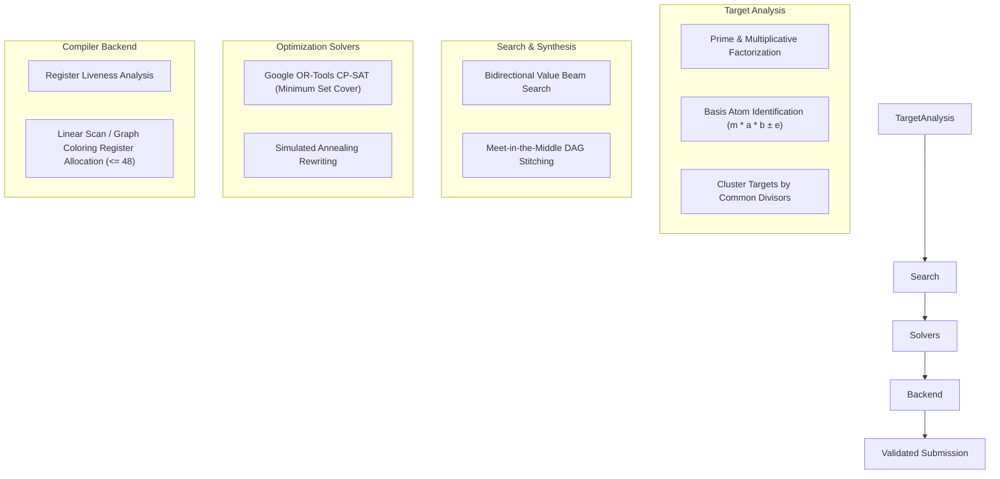

# Algorithmic Strategies & Solution Methods

The Elf Calculator optimization problem belongs to the family of **Straight-Line Program (SLP) Synthesis**, **Addition-Subtraction-Multiplication-Division Chains**, and **Constrained Expression DAG Generation**.

---

## 1. Problem Formulation as a Directed Acyclic Graph (DAG)

Generating a set of target integers $T = \{t_1, t_2, \dots, t_m\}$ from seed values $S = \{s_1, \dots, s_k\}$ can be modeled as constructing a minimal Directed Acyclic Graph (DAG):
* **Input Leaves:** Starting seed values ($r_0, \dots, r_{k-1}$).
* **Internal Nodes:** Arithmetic operations ($+, -, *, /$) producing intermediate helper values $h_j$.
* **Target Nodes:** Nodes whose output values equal elements of $T$.
* **Constraint:** The DAG must have an topological register assignment requiring $\le 48$ simultaneous registers.

$$\text{Global Objective: } \min \sum_{p=1}^{1000} |V_{\text{internal}}(p)|$$

---

## 2. Why the Baseline Score is 1,490,379 and How to Beat It

Our empirical audit of `sample_submission.csv` reveals why the baseline score is so large:
1. **Zero Subtractions:** The baseline never uses `-`.
2. **Single Division:** Division `/` is only used once to produce the number `1`.
3. **Zero Value Sharing:** Targets are built independently using repeated doubling ($+$) and incrementing ($+1$), scaling as $\mathcal{O}(\log_2(T))$ per target:
   $$\text{Instructions per puzzle} \approx \sum_{t \in T} \approx 50 \times 30 \approx 1,500$$
4. **Optimization Opportunity:** By using multi-target shared DAGs, inverse factorization, and register reuse, the score can be cut by **over 90%** (down to ~130,000 instructions).

---

## 3. Top Community & Grandmaster Strategies

### A. Bidirectional Beam Search
* **Forward Frontier:** From starting values, expand reachable values via $+$, $*$, $-$, and valid $/$. Retain candidate values that have high overlap with target prime factors or multiples.
* **Backward Frontier:** For each target $t \in T$:
  * If $t$ is composite, factor $t = a \times b$.
  * If $t$ is near a product, express as $t = (a \times b) \pm c$.
  * If $t$ has a multiplier $m$, express as $t = \frac{t \times m}{m}$.
* **Meet-in-the-Middle:** Connect forward and backward states to build minimal paths.

### B. Common Sub-Expression Elimination & Shared Atoms
* In `practice_puzzles.csv`, $25.5\%$ of puzzles are categorized as `shared` and $20\%$ as `multiplicative`.
* Identify "keystone" intermediate values that can branch into 3–10 distinct targets in 1–2 steps.
* Rather than synthesizing target values independently, prioritize paths that maximize reuse.

### C. Constraint Programming with Google OR-Tools CP-SAT
1. **Recipe Generation:** Run fast stochastic searches to collect 100–500 valid derivation recipes for every target.
2. **Formulate Integer Program:**
   * Decision variable $y_i \in \{0, 1\}$ indicates whether operation $i$ is included.
   * Constraint: For every target $t \in T$, at least one valid recipe generating $t$ must be selected.
   * Constraint: If recipe $R = (u \text{ op } v)$ is selected, recipes producing $u$ and $v$ must be selected.
   * Objective: $\min \sum y_i$.
3. CP-SAT finds the globally minimal combination of instructions that covers all targets.

### D. Register Allocation & Liveness Scheduling
* Because registers are capped at 48, a valid DAG must be sequenced:
  1. Determine the **live range** of each intermediate value $[\text{first\_def}, \text{last\_use}]$.
  2. Apply a linear scan register allocator to assign register indices $[0, 47]$.
  3. Reclaim registers as soon as their value has been used by its final dependent instruction.
